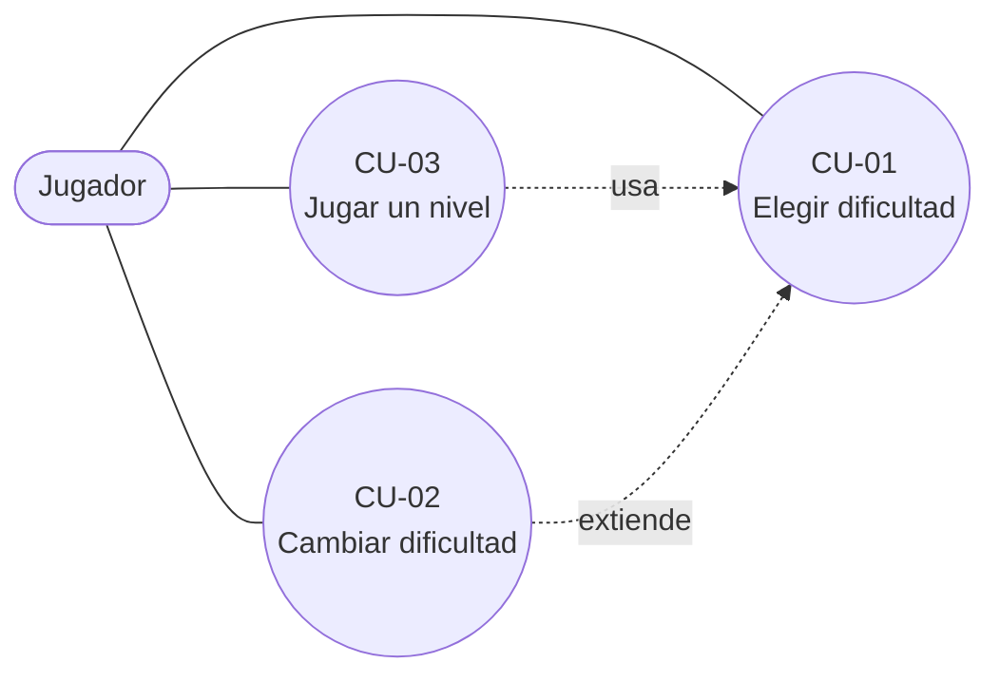
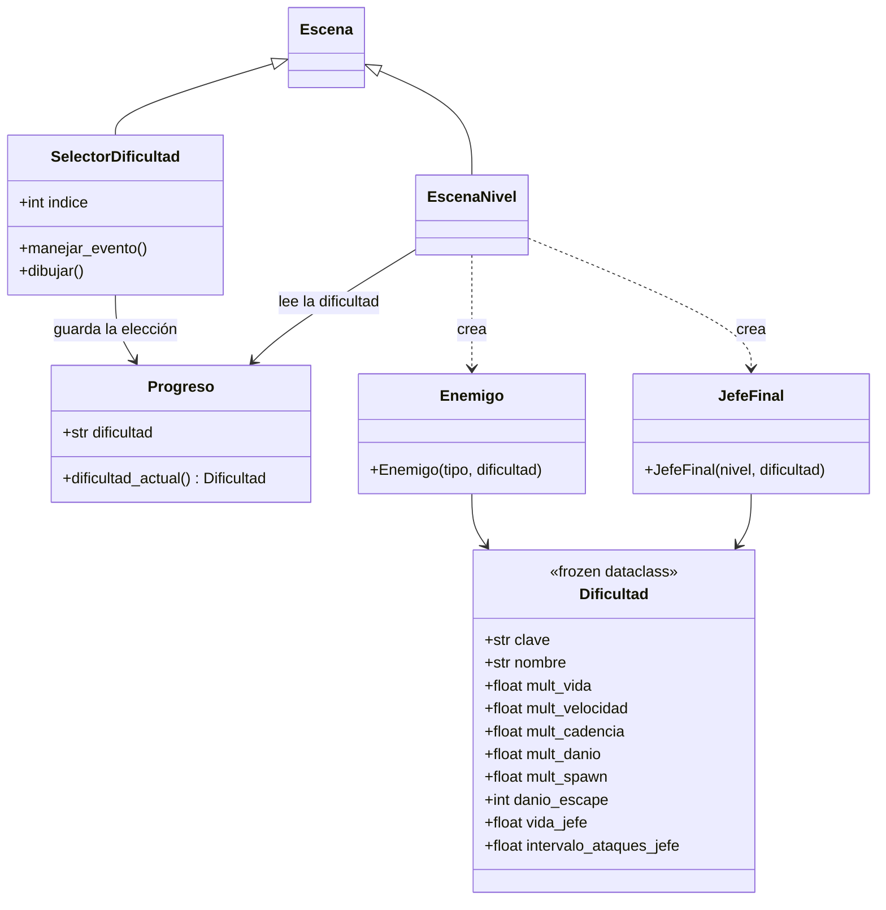
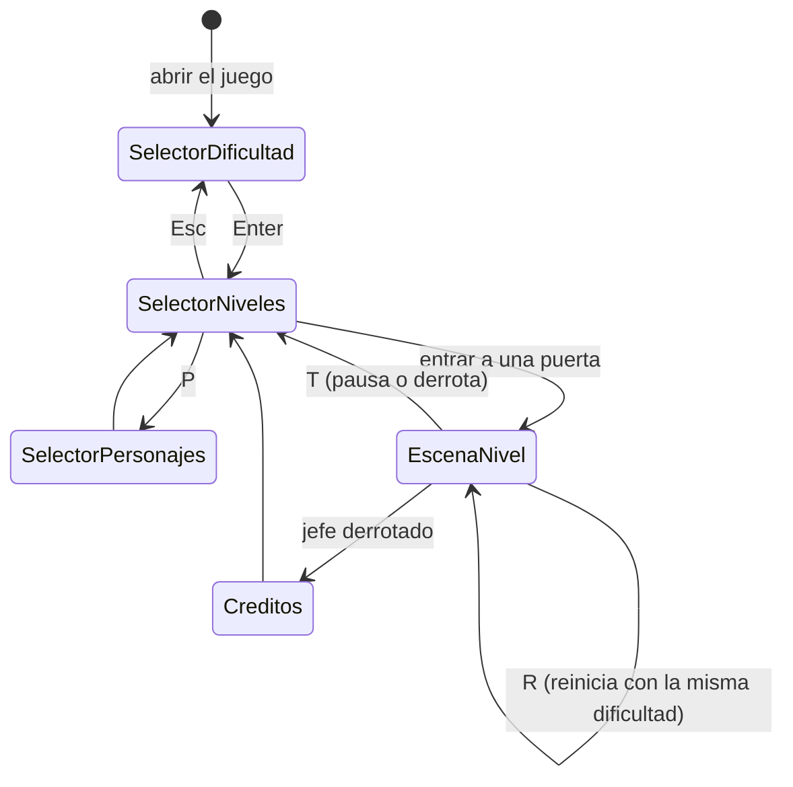

# Pixel Strike — Selector de dificultad

Diseño previo a la implementación. Todo lo que dice "hoy" describe el código actual del repo.

## 1. Objetivo y alcance

Agregar una pantalla de **selección de dificultad** que aparece al iniciar el programa, antes del selector de niveles, y que ajusta la dureza de los enemigos y del jefe.

Fuera de alcance por ahora: guardar progreso o dificultad en disco (hoy `Progreso` vive solo en memoria), puntajes y dificultades personalizadas.

## 2. Requisitos

### Funcionales

| ID | Requisito |
|---|---|
| RF-01 | Al abrir el juego se muestra el selector de dificultad, antes del selector de niveles |
| RF-02 | Hay tres dificultades: Fácil, Normal y Difícil. Normal reproduce exactamente el juego actual |
| RF-03 | Se navega con W/S (o A/D) y se confirma con Enter; suena `clickButton.mp3` al moverse |
| RF-04 | La dificultad elegida afecta a los niveles de hordas (1 a 3) y al jefe (nivel 4) |
| RF-05 | El tutorial (nivel 0) siempre se juega en Normal, para que las instrucciones no cambien |
| RF-06 | Se puede volver al selector de dificultad desde el selector de niveles (tecla Esc) para cambiarla |
| RF-07 | Cambiar la dificultad no borra niveles ni personajes desbloqueados |
| RF-08 | Reiniciar un nivel (R) o morir conserva la dificultad elegida |
| RF-09 | La dificultad actual se ve en pantalla en el selector de niveles |

### No funcionales

| ID | Requisito |
|---|---|
| RNF-01 | Los parámetros de cada dificultad son datos en `datos.py`, no `if` repartidos por el código |
| RNF-02 | Los datos base (`DatosEnemigo`, `DatosArma`) son inmutables y no se tocan: la dificultad se aplica al crear cada enemigo |
| RNF-03 | Con Normal el comportamiento es idéntico al actual (verificado con tests) |
| RNF-04 | Si falta algún asset del menú, el juego no se rompe (mismo criterio de placeholders que hoy) |

## 3. Casos de uso



| ID | Caso de uso | Flujo principal |
|---|---|---|
| CU-01 | Elegir dificultad | 1. Abre el juego. 2. Ve las tres opciones con Normal preseleccionada. 3. Navega con W/S. 4. Confirma con Enter. 5. Pasa al selector de niveles |
| CU-02 | Cambiar dificultad | 1. Desde el selector de niveles presiona Esc. 2. Elige otra opción. 3. Vuelve al selector de niveles con su progreso intacto |
| CU-03 | Jugar un nivel | 1. Entra a una puerta. 2. Los enemigos y el jefe nacen con los valores de la dificultad elegida |

## 4. Modelo



### Parámetros propuestos

Los valores de Normal son los actuales. Los de Fácil y Difícil son una primera propuesta, para ajustar jugando.

| Parámetro | Fácil | Normal | Difícil | Qué cambia hoy en el código |
|---|---|---|---|---|
| `mult_vida` (enemigos) | ×0,5 | ×1 | ×1,5 | `Enemigo.vida` (alien 20, crawler 30) |
| `mult_velocidad` | ×0,8 | ×1 | ×1,25 | `Enemigo._intervalo_paso` (se divide) |
| `mult_cadencia` (disparo enemigo) | ×1,25 | ×1 | ×0,8 | `Enemigo._t_disparo` y su reinicio |
| `mult_danio` (balas enemigas) | ×0,5 | ×1 | ×1,5 | daño de `BalaEnemigo` al crearse |
| `mult_spawn` (tiempo entre enemigos) | ×1,25 | ×1 | ×0,75 | `_oleada`: intervalo del sorteo |
| `danio_escape` | 10 | 15 | 20 | `enemigo_escapo` |
| `vida_jefe` | 100 | 150 | 225 | `JefeFinal.VIDA_MAX` |
| `intervalo_ataques_jefe` | 1,4 s | 1,1 s | 0,8 s | `sim.cada(1.1, ...)` en `comenzar_ataques` |

Para el daño del jefe: las bolas de fuego usan `mult_danio` a través de su arma y los ataques de área usan `DANIO_FUEGO` (hoy constante del módulo), que también se escalaría.

### Decisiones de diseño y cuidados

- **La elección vive en `Progreso`**, que ya es el estado compartido entre pantallas.
- **No se usa `Jugador.defensa` para el daño recibido**: el power up de defensa lo pone en 0 al activarse y lo **restaura a 1** al terminar, así que borraría el multiplicador de la dificultad. El daño se escala en el origen, cuando nace la bala enemiga.
- **Los intervalos de aparición pasan de enteros a decimales**: hoy `random.randint(spawn_min, spawn_max)`; con multiplicadores como 1,25 hay que sortear con `random.uniform`. Con Normal el rango sigue siendo el mismo.
- **Constructores con valor por defecto**: `Enemigo(tipo, dificultad=NORMAL)` y `JefeFinal(nivel, dificultad=NORMAL)`, así el tutorial y el resto del código no cambian.
- **La vida del jugador no se toca**: cambiar `vida_max` cambiaría la cantidad de corazones del HUD y la ventaja de Kratos.

## 5. Flujo de pantallas



## 6. Mockup de la pantalla

Lienzo de 1600×900. Se propone reutilizar un fondo existente, oscurecido, y dibujar el texto con `pygame.font`.

```
+------------------------------------------------------------+
|                                                            |
|                      PIXEL STRIKE                          |
|                                                            |
|                  Elegí la dificultad                       |
|                                                            |
|                   [   FÁCIL    ]                           |
|                 > [  NORMAL    ] <      (resaltada)        |
|                   [  DIFÍCIL   ]                           |
|                                                            |
|        Enemigos con la mitad de vida, más lentos...        |
|                                                            |
|              W/S: elegir        Enter: confirmar           |
+------------------------------------------------------------+
```

Debajo de las opciones, una línea corta describe la dificultad resaltada.

## 7. Cambios por archivo

| Archivo | Cambio |
|---|---|
| `datos.py` | Clase `Dificultad`, constantes `FACIL`, `NORMAL`, `DIFICIL` y `ORDEN_DIFICULTADES` |
| `progreso.py` | Atributo `dificultad` (por defecto `"normal"`) y `dificultad_actual()` |
| `ajustes.py` | `TECLA_VOLVER = K_ESCAPE` |
| `recursos.py` | Método `fuente(tam)` con cache; usa `assets/fuente.ttf` si existe y la fuente por defecto si no |
| `escenas_menu.py` | Nueva `SelectorDificultad`; en `SelectorNiveles`, Esc vuelve a ella y se dibuja la dificultad actual |
| `juego.py` | `ir_a_selector_dificultad()` y arrancar ahí en vez de en el selector de niveles |
| `entidades.py` | `Enemigo` recibe la dificultad; `BalaEnemigo` toma el daño ya escalado |
| `escena_nivel.py` | Pasa la dificultad al crear enemigos y jefe (el tutorial usa Normal); escala `_oleada` y `enemigo_escapo` |
| `jefe.py` | Vida, intervalo de ataques y daño según la dificultad |
| `README.md` | Documentar la pantalla, la tecla Esc y la tabla de dificultades |

## 8. Plan de pruebas

El repo todavía no tiene tests; se agregaría `tests/test_dificultad.py`, ejecutable sin ventana (`SDL_VIDEODRIVER=dummy`):

- **Sin regresión**: con Normal, `Enemigo` tiene la misma vida, intervalo y daño que sin dificultad.
- **Multiplicadores**: en Fácil y Difícil cambian vida, velocidad, cadencia, daño de bala, escape y jefe como dice la tabla.
- **Defensa**: con el power up de defensa activo y vencido, el daño sigue escalado.
- **Selector**: navega, no se pasa de los bordes, Enter guarda en `Progreso` y pasa al selector de niveles.
- **Flujo**: el juego arranca en el selector de dificultad; Esc vuelve y conserva niveles y personajes desbloqueados.
- **Tutorial**: siempre en Normal, aunque se haya elegido Difícil.
- **Humo**: recorrer los cinco niveles en cada dificultad sin errores.
